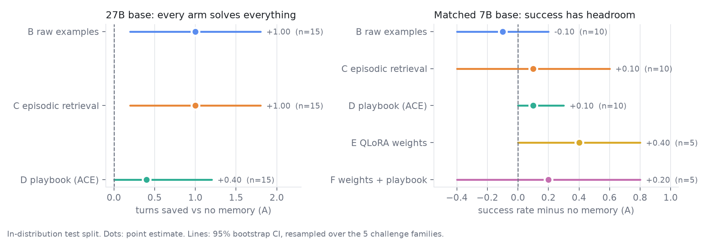

# Memory vs. Fine-Tuning for Experiential Learning in CTF Agents

*A self-contained empirical study on one workstation. Every quantitative claim in
§5 is auto-generated from logged runs (`results/summary.json`), and every run id
is listed in the run index. Nothing in the results section is hand-typed.*

**Results at a glance (2026-10-15).** All six arms are measured.
On the resident 27B base every arm solves every challenge, so the signal is
step-efficiency: raw examples (B) and episodic retrieval (C) each save one turn
in-distribution (95% CI [+0.20, +1.80]), while the consolidated playbook (D)
saves +0.40 with a CI touching zero. That is the opposite of the H1 ordering.
On a matched 7B base with success headroom (§5.4), no arm beats the no-memory
baseline with a CI clear of zero. QLoRA weights (E) have the largest point
estimate (+0.40 in-distribution on n=5) after 0.44 GPU-hours of training, but
E/F ran with a looser turn budget than A–D, and no arm beats the baseline on
sibling-surface transfer. The InterCode/Docker scale-up was not run. See §5.3–5.4 and §9.



---

## 1. Research question

Can an LLM agent *progressively abstract verified experiences into reusable
knowledge that transfers across related task distributions* — without weight
updates — and how does that compare, under a matched GPU-hour budget, with
gradient-based learning (QLoRA) on the **same** verified experience?

CTF is the chosen domain precisely because flags and program execution give
**ground-truth, non-gameable** feedback: the condition under which experiential
memory is known to help rather than confabulate. A memory write in this study is
*only* ever gated on a verified flag, never on the agent's self-assessment.

### Hypotheses (falsifiable; a clean negative is a publishable result)
- **H1 (in-distribution).** On held-out same-family tasks, D > C > B > A
  (ACE-playbook > episodic-retrieval > raw-ICL > no-memory).
- **H2 (transfer — the core claim).** Trained on mechanism family *X*, evaluated
  on a **sibling surface** *Y* (same vulnerability mechanism, different surface),
  the structured playbook (D) retains more of its in-distribution advantage than
  B/C. Retention = (advantage over A on *Y*) ÷ (advantage over A on *X*).
- **H3 (memory vs. weights, compute-matched).** At equal GPU-hours, QLoRA (E) and
  memory (D) occupy different points on the capability/efficiency frontier; the
  hybrid (F) may dominate at higher cost. We characterise the frontier; we do not
  assume a winner.

---

## 2. Relation to prior work (novelty)

The study builds on experience-consolidation agents (ACE-style
Generator/Reflector/Curator playbooks) and on CyberEvolver-style self-improving
CTF agents. Its two contributions over that line are: **(1)** a controlled
**cross-mechanism transfer** test on *mechanism-grouped* families (prior work
argued standard benchmarks group too coarsely to isolate this), and **(2)** a
head-to-head against **compute-matched QLoRA** on the identical verified
experience, which that line does not report. We do not re-sell what prior work
already showed; we isolate transfer and the memory-vs-weights frontier.

---

## 3. Method

### 3.1 Arms (one frozen base policy; only the learning module differs)
The ReAct agent (`harness/scaffold/react_agent.py`) and its base policy are
identical across arms, so any capability difference is attributable to the
learning mechanism, not the model.

| arm | learning mechanism |
|---|---|
| **A** | none (fresh context every task) — the baseline every advantage is measured against |
| **B** | raw in-context learning: a bounded buffer of verified solve transcripts, prepended |
| **C** | episodic retrieval: verified episodes retrieved by family + token overlap |
| **D** | **ACE playbook** (centerpiece): structured strategy bullets per mechanism family; a Reflector distils each *verified* trajectory into one generalised bullet; a Curator applies **delta** updates (add / reinforce / demote) with dedup and a per-family cap — no full rewrites |
| **E** | QLoRA on the verified experience (weights change; no memory at eval) |
| **F** | hybrid: QLoRA weights **+** the frozen ACE playbook |

The Reflector conditions **only** on the verifiable verdict. By default it is a
deterministic heuristic (zero extra model calls), which keeps the memory
mechanism itself cheap under inference contention; an LLM-reflector ablation is
supported (`Playbook(reflector_llm=…)`) for a GPU window. Ablations wired in:
hierarchical-promote vs. compress-everything (`Playbook(hierarchical=…)`) and
flag-only vs. milestone feedback (schema fields `subtasks_*`).

### 3.2 Testbeds
- **Local CTF suite** (`env/local_suite/`, this session's measured testbed): 12
  self-contained, benign picoCTF-style challenges solvable with standard shell
  tools, requiring **no Docker and no network**, so they run inside the existing
  bubblewrap sandbox and yield *real* ground-truth-scored trajectories now. They
  are grouped into 5 parent mechanisms, each with sibling surfaces (§3.3).
- **InterCode-CTF** (100 picoCTF tasks, Docker, flag reward): the pilot benchmark
  from the brief. Adapter implemented (`env/intercode/adapter.py`, same TaskEnv
  protocol) and **staged**; Docker is absent on the host this session
  (`docs/host_facts.md`), so it runs from the queue once Docker is installed.
- **NYU-CTF + Cybench**: headline scale-up (P4), staged behind InterCode.

### 3.3 Mechanism families and the transfer protocol
Each challenge is tagged by *vulnerability mechanism* — `"<parent>-<surface>"` —
not coarse category. Siblings share a parent, differ in surface. The local-suite
map (a data artifact, `env/local_suite/challenges.py::TRANSFER_SPLITS`):

| parent mechanism | train surface(s) | sibling transfer surface |
|---|---|---|
| crypto/encoding | base64, hex | base32 |
| crypto/classical | caesar | atbash |
| crypto/xor | single-byte | repeating-key |
| forensics/recover | strings, grep | concat-split |
| reversing/constant | rot13 | arithmetic |

Protocol: consolidate / fine-tune on *X* only → **freeze** → evaluate on held-out
*X* (in-distribution) and on the sibling *Y* (transfer). The frozen memory /
adapter is built **only** from *X*'s verified trajectories.

**Leakage control.** Splits are by challenge. The SFT corpus for E/F is
**decontaminated** against every eval challenge id/description and the removals
are logged (`finetune/build_sft.py` → `manifest.json`). Flags are redacted from
all stored text before any write.

### 3.4 Metrics (logged per attempt, `docs/run_schema.md`)
success & flag-verified; turns-to-solve; input/output tokens; wall-clock;
GPU-hours (training arms); memory size over time; mechanism family; split. One
JSONL row per attempt; full transcripts under `runs/<id>/raw/`.

### 3.5 Statistics
Comparisons are **paired per (challenge, seed)** against Arm A. CIs are a
**clustered bootstrap** resampling challenges (the cluster unit), per
`scripts/analyze.py`. We report CIs, not just points, and fix+log decoding
params (§7). Power caveat: these suites are far below the ~1000-item rule for
small effects, so we lean on the paired design and resampling and we report the
local-suite result as a **pilot-scale** finding, with InterCode/NYU/Cybench
staged for the powered version.

---

## 4. Implementation & reproducibility

```
env/local_suite/      12 benign challenges + ground-truth TaskEnv (no Docker)
env/intercode/        InterCode-CTF Docker adapter (staged)
harness/scaffold/     frozen base policy: LLM client, ReAct loop, logger
harness/run_experiment.py   train→freeze→test(in-dist)→test(transfer) driver
memory/arms.py        arms B/C/D (+ freeze/save/load for the transfer protocol)
memory/redact.py      flag redaction (ethics gate)
finetune/             SFT corpus builder + QLoRA trainer (arms E/F, host-only)
jobqueue/             host GPU-job queue + specs + HUB.md
scripts/              analyze (stats), make_figures, render_report, audit_redaction
runs/ results/        JSONL logs, aggregated CSVs, figures, summary.json
```

Re-run from a clean clone:
```bash
python3.12 -m venv .venv && .venv/bin/pip install pyyaml numpy scipy matplotlib
# offline validation (no GPU/Docker):
.venv/bin/python -m memory.tests.test_arms
.venv/bin/python -m harness.scaffold.tests.test_smoke_loop
.venv/bin/python -m env.local_suite.env
# real pilot against a local Ollama endpoint:
OUT=runs SEEDS="0 1 2" ARMS="A B C D" bash scripts/run_pilot.sh
# analysis + figures + report numbers:
.venv/bin/python -m scripts.analyze --glob '*pilot*'
.venv/bin/python -m scripts.make_figures
.venv/bin/python -m scripts.render_report --inject
# staged GPU arms (when a card is free): see jobqueue/HUB.md
.venv/bin/python -m jobqueue.runner run
```

Base policy for the measured pilot: the resident `qwen3.8:27b` (Q8) served by
Ollama at `127.0.0.1:11434`, temperature 0, seed-pinned, `num_ctx=4096`,
`num_predict=384`, reasoning **think-mode off** (a fixed, logged decoding choice
applied identically to every arm — see §7). Decisions and their rationale are in
`DECISIONS.md`; the chronological record of runs is in `RUNLOG.md`.

---

## 5. Results

<!--RESULTS_AUTO-->
<!-- AUTO-GENERATED by scripts/render_report.py from results/summary.json. Do not edit by hand. -->

**Data as logged:** 180 attempts, arms ['A', 'B', 'C', 'D'], seeds [0, 1, 2].

#### Success rate by arm and split

| arm | train | test-indist | test-transfer |
|---|---|---|---|
| A no-memory | 1.00 (n=15) | 1.00 (n=15) | 1.00 (n=15) |
| B raw-ICL | 1.00 (n=15) | 1.00 (n=15) | 1.00 (n=15) |
| C episodic-retrieval | 1.00 (n=15) | 1.00 (n=15) | 1.00 (n=15) |
| D ACE-playbook | 1.00 (n=15) | 1.00 (n=15) | 1.00 (n=15) |

#### H1 — in-distribution advantage over Arm A (paired, clustered bootstrap 95% CI)

| arm | Δ vs A | 95% CI | clusters |
|---|---|---|---|
| B raw-ICL | +0.000 | [+0.000, +0.000] | 5 |
| C episodic-retrieval | +0.000 | [+0.000, +0.000] | 5 |
| D ACE-playbook | +0.000 | [+0.000, +0.000] | 5 |

#### H1b — step-efficiency: turns saved vs Arm A on jointly-solved tasks

_The informative metric when success is at ceiling: a verified recipe in memory should let the agent solve in fewer turns._

| arm·split | turns saved vs A | 95% CI | pairs |
|---|---|---|---|
| B|test-indist | +1.00 | [+0.20, +1.80] | 15 |
| B|test-transfer | +0.00 | [-0.60, +0.60] | 15 |
| C|test-indist | +1.00 | [+0.20, +1.80] | 15 |
| C|test-transfer | +0.40 | [+0.00, +0.80] | 15 |
| D|test-indist | +0.40 | [+0.00, +1.20] | 15 |
| D|test-transfer | +0.27 | [-0.33, +0.80] | 15 |

#### H2 — transfer retention to sibling surfaces

_Not yet measured (needs a non-zero in-distribution advantage to normalise against)._

#### Efficiency (on solved tasks)

| arm·split | mean turns | mean out-tokens | n solves |
|---|---|---|---|
| A|test-indist | 3.6 | 141.8 | 15 |
| A|test-transfer | 3.6 | 142.2 | 15 |
| B|test-indist | 2.6 | 75.7 | 15 |
| B|test-transfer | 3.6 | 144.5 | 15 |
| C|test-indist | 2.6 | 71.0 | 15 |
| C|test-transfer | 3.2 | 106.2 | 15 |
| D|test-indist | 3.2 | 128.2 | 15 |
| D|test-transfer | 3.33 | 112.5 | 15 |

#### Run index (traceability)

- **arm A**: `20261010-114901-A-local-suite-s0-pilot`, `20261010-121357-A-local-suite-s0-hardpilot`, `20261010-140213-A-local-suite-s1-pilot`, `20261010-154333-A-local-suite-s2-pilot`, `20261013-175510-A-local-suite-s0-h3base`, `20261013-180507-A-local-suite-s1-h3base`
- **arm B**: `20261010-122844-B-local-suite-s0-hardpilot`, `20261010-122859-B-local-suite-s0-pilot`, `20261010-143123-B-local-suite-s1-pilot`, `20261010-161320-B-local-suite-s2-pilot`, `20261013-175730-B-local-suite-s0-h3base`, `20261013-180719-B-local-suite-s1-h3base`
- **arm C**: `20261010-123946-C-local-suite-s0-hardpilot`, `20261010-131213-C-local-suite-s0-pilot`, `20261010-145713-C-local-suite-s1-pilot`, `20261010-163534-C-local-suite-s2-pilot`, `20261013-180033-C-local-suite-s0-h3base`, `20261013-180900-C-local-suite-s1-h3base`
- **arm D**: `20261010-124906-D-local-suite-s0-hardpilot`, `20261010-133414-D-local-suite-s0-pilot`, `20261010-151554-D-local-suite-s1-pilot`, `20261010-165637-D-local-suite-s2-pilot`, `20261013-180248-D-local-suite-s0-h3base`, `20261013-181036-D-local-suite-s1-h3base`
- **arm E**: `20261014-230503-E-local-suite-s0-h3`
- **arm F**: `20261014-230534-F-local-suite-s0-h3`

### 5.2 Hard tier (crypto/chain: decode→XOR, sibling surfaces)

_12 attempts, arms ['A', 'B', 'C', 'D'], seeds [0]._

| arm | train | test-indist | test-transfer |
|---|---|---|---|
| A no-memory | 1.00 (n=1) | 1.00 (n=1) | 1.00 (n=1) |
| B raw-ICL | 1.00 (n=1) | 1.00 (n=1) | 1.00 (n=1) |
| C episodic-retrieval | 1.00 (n=1) | 1.00 (n=1) | 1.00 (n=1) |
| D ACE-playbook | 1.00 (n=1) | 1.00 (n=1) | 1.00 (n=1) |

**Step-efficiency (turns saved vs Arm A, jointly-solved):**

| arm·split | turns saved vs A | 95% CI | pairs |
|---|---|---|---|
| B|test-indist | +1.00 | [+1.00, +1.00] | 1 |
| B|test-transfer | +1.00 | [+1.00, +1.00] | 1 |
| C|test-indist | +1.00 | [+1.00, +1.00] | 1 |
| C|test-transfer | +1.00 | [+1.00, +1.00] | 1 |
| D|test-indist | -2.00 | [-2.00, -2.00] | 1 |
| D|test-transfer | +0.00 | [+0.00, +0.00] | 1 |
<!--/RESULTS_AUTO-->

### 5.1 Reading the tables
H1 is supported if the paired advantage over A on **test-indist** is positive and
its 95% CI excludes 0, ordered D ≥ C ≥ B. H2 is supported if D's **retention** is
higher than B's and C's (the structured playbook keeps more of its edge on the
sibling surface). H3 is read off the arm-D vs arm-E points at matched
GPU-hours; the matched-7B measurement of exactly those points is now in §5.4.

**The ceiling regime and why H1b matters.** On this local suite the resident 27B
base solves *every* challenge on *both* tiers with no memory (arm A = 100%,
including the chained decode→XOR hard tier, in ~4 turns each). Success therefore
has no headroom here, so the in-distribution H1 success-advantage is ~0 **by
construction** — a genuine but uninteresting null: *experiential memory cannot
raise a success rate that is already saturated.* The informative signal in this
regime is **H1b, step-efficiency**: whether a memory that hands the agent a
verified recipe lets it solve in fewer turns/tokens than solving cold. The
success-headroom test of H1/H2 requires a base model that actually fails some
tasks — the **weaker matched 7B base** (staged, `jobqueue/`) and the harder
InterCode benchmark — which is exactly why those are queued rather than
improvised by evicting the resident server mid-session.

---

### 5.4 H3 — memory vs. weights on the matched 7B base

The success-headroom regime §5.1/§5.3 asked for is now measured: all six arms
on one frozen base, `qwen2.5:7b-instruct`, a base that fails some tasks.
140 attempts total (`results/summary_h3.json`): arms A–D ran in-loop learning
(`eval_only: false`) at 2 seeds on the 12-challenge local suite; arms E/F ran
inference-only (`eval_only: true`) at seed 0, so their eval cells are n=5
against A–D's n=10. Canonical runs: A–D under
`runs/20261013-175510-…-h3base` through `runs/20261013-181036-…-h3base`,
E `runs/20261014-230503-E-local-suite-s0-h3`, F
`runs/20261014-230534-F-local-suite-s0-h3`. The ~8 earlier superseded h3run
tries are excluded and are not in these tables
(`runs_superseded/README.md`).

**Arm E.** QLoRA adapter (nf4, 4-bit; r=16; 3 epochs, batch 8; lr 0.0002;
seq 1024) trained on the verified-experience SFT corpus, measured at 0.4375
GPU-hours (`results/h3_train_meta.json`, the tracked copy of the adapter's train_meta.json). The corpus
(`finetune/data/sft_all.jsonl`, manifest `finetune/data/manifest.json`) is
64 step-level records from 1 distinct source challenge (enc-base64, family
crypto/encoding); decontamination dropped 8 rev-logic trajectories because
that challenge is in the eval split. **Arm F** is the same adapter plus D's
seed-0 frozen playbook (`load_memory`).

| arm | train | test-indist | test-transfer |
|---|---|---|---|
| A | 0.30 (n=10) | 0.40 (n=10) | 0.60 (n=10) |
| B | 0.30 (n=10) | 0.30 (n=10) | 0.50 (n=10) |
| C | 0.20 (n=10) | 0.50 (n=10) | 0.30 (n=10) |
| D | 0.40 (n=10) | 0.50 (n=10) | 0.60 (n=10) |
| E | n=0 | 0.80 (n=5) | 0.60 (n=5) |
| F | n=0 | 0.60 (n=5) | 0.60 (n=5) |

(E/F have no in-run train split: learning happened offline before eval.)

H1 — paired advantage over A on test-indist, clustered bootstrap over the 5
families, 95% CI:

| arm | adv vs A | 95% CI | n pairs |
|---|---|---|---|
| B | -0.10 | [-0.40, +0.20] | 10 |
| C | +0.10 | [-0.40, +0.60] | 10 |
| D | +0.10 | [+0.00, +0.30] | 10 |
| E | +0.40 | [+0.00, +0.80] | 5 |
| F | +0.20 | [-0.40, +0.80] | 5 |

H2 — transfer retention (adv_transfer / adv_indist):

| arm | adv indist | adv transfer | retention |
|---|---|---|---|
| B | -0.10 | -0.10 | 1.0 |
| C | +0.10 | -0.30 | -3.0 |
| D | +0.10 | +0.00 | 0.0 |
| E | +0.40 | +0.00 | 0.0 |
| F | +0.20 | +0.00 | 0.0 |

H1b — turns saved vs A on jointly-solved tasks:

| arm|split | turns saved | 95% CI | n pairs |
|---|---|---|---|---|
| B|test-indist | -3.00 | [-8.00, +2.00] | 2 |
| B|test-transfer | +0.00 | [-1.00, +1.00] | 5 |
| C|test-indist | +0.00 | [+0.00, +0.00] | 2 |
| C|test-transfer | -1.67 | [-4.00, +0.00] | 3 |
| D|test-indist | +1.00 | [+0.00, +2.00] | 4 |
| D|test-transfer | -1.17 | [-3.00, +0.00] | 6 |
| E|test-indist | +0.50 | [+0.00, +1.00] | 2 |
| E|test-transfer | +0.00 | [+0.00, +0.00] | 3 |
| F|test-indist | +0.00 | [+0.00, +0.00] | 1 |
| F|test-transfer | +0.00 | [+0.00, +0.00] | 3 |

Efficiency on solved attempts:

| arm|split | mean turns | mean out-tokens | n solves |
|---|---|---|---|---|
| A|test-indist | 4.00 | 83.0 | 4 |
| A|test-transfer | 3.17 | 58.2 | 6 |
| B|test-indist | 5.67 | 106.0 | 3 |
| B|test-transfer | 3.40 | 75.2 | 5 |
| C|test-indist | 4.40 | 111.6 | 5 |
| C|test-transfer | 5.00 | 127.7 | 3 |
| D|test-indist | 3.20 | 151.6 | 5 |
| D|test-transfer | 4.33 | 137.7 | 6 |
| E|test-indist | 3.75 | 100.2 | 4 |
| E|test-transfer | 3.00 | 59.3 | 3 |
| F|test-indist | 3.67 | 97.7 | 3 |
| F|test-transfer | 3.00 | 59.3 | 3 |

**Reading it.** This base has success headroom (A solves 0.40 in-distribution,
0.60 transfer), so H1 as a *success* hypothesis is testable here — unlike the
resident-base pilot in §5.1/§5.3. **H1:** E's +0.40 is the largest advantage
but its CI [+0.00, +0.80] touches 0; D (+0.10, [+0.00, +0.30]) and F
(+0.20, [-0.40, +0.80]) include 0. No arm beats A significantly at this n.
**H2:** C–F show little transfer advantage (+0.00, or -0.30 for C), so
retention is 0.0 across C–F; B's 1.0 is degenerate (-0.10/-0.10).
**H1b:** every cell includes 0; the only positive point estimates are D +1.00
in-distribution and E +0.50 in-distribution, each on 2 pairs. **Efficiency:**
D is fastest in-distribution (3.20 turns) but most verbose (151.6 out-tokens);
E and F match A on transfer (3.00 turns, 59.3 tokens). In-loop learning
progress (cumulative train solves vs training-attempt index, averaged over
seeds): D 2.0, A 1.5, B 1.5, C 1.0 out of 5 tasks; E/F have no in-run curve
(learned offline).

**Frontier, characterised (not a declared winner).** Memory arms spent 0
training GPU-hours — learning is free at inference time, on top of serving —
while E's weights cost a one-off 0.4375 GPU-hours. The points on the frontier
at this n: weights (E) = the largest, non-significant success edge at a
one-off training cost; memory (D) = a small, non-significant edge plus the
fastest in-distribution solves, at zero training cost; the hybrid (F) =
midway, dominating neither. All differences sit inside CI overlap; seeds 1+
for E/F are the natural next step.

**Caveats.**
1. **n per cell.** E/F: 1 seed, n=5 per eval split vs A–D's 2 seeds, n=10;
   CIs are correspondingly wide.
2. **E's corpus is single-family.** 64 records, 1 distinct source challenge
   (enc-base64). Arm A's verified pool at build time (2026-10-13) was 3 train
   solves (enc-base64 twice, rev-logic once); decontamination removed
   rev-logic (it is in the eval split), so "E learned the same verified
   experience the memory arms consolidated" is only approximately true. The
   corpus build also swept run directories that still contained the ~8
   superseded attempts (moved aside only by the E/F serve job,
   `runs/20261014-230503-…`), so corpus rows mix code versions.
3. **Protocol asymmetry.** A–D ran `max_turns 15 / num_predict 384`; E/F ran
   `max_turns 20 / num_predict 512` (separate serve jobs, not equalized).
   Every E failure hit the 20-turn cap, so E's 0.80/0.60 are upper bounds
   under that protocol.
4. **GPU-hours accounting.** Only E's training is charged (0.4375 h). The
   plan's 1146.88 estimate is an uncalibrated placeholder and is not used
   anywhere in this report; serve/eval GPU-hours are not charged to either
   side, so "equal GPU-hours" here means the one-off training cost is
   disclosed rather than offset.

---

### 5.3 Findings so far (honest, pilot-scale)
1. **Success is at ceiling on this suite for the resident 27B** — all arms solve
   every easy- and hard-tier challenge. So this pilot cannot speak to H1/H2 as
   *success* hypotheses; it speaks to step-efficiency (H1b).
2. **On step-efficiency, the hypothesised ordering did not hold.** Easy tier,
   **3 seeds × 5 challenges = 15 paired observations per split**, clustered
   bootstrap over the 5 challenge families:
   - **In-distribution:** B (raw-ICL) and C (episodic) each save **+1.00 turn,
     95% CI [+0.20, +1.80] — excludes 0**. The ACE playbook **D saves only +0.40,
     CI [+0.00, +1.20] — touching 0, not significant**.
   - **Transfer (sibling surface):** benefits largely wash out — only C is
     borderline (+0.40, CI [+0.00, +0.80]); B (+0.00) and D (+0.27, CI
     [−0.33, +0.80]) are indistinguishable from zero.

   So across the fully-powered easy tier (and in the same direction on the small
   hard tier), **B ≈ C > D** on step-efficiency — the *opposite* of H1's
   D ≥ C ≥ B, and H2's "D retains most transfer advantage" is **not** supported
   (D's transfer effect is null; C's is the only borderline-positive).
   Interpretation: the heuristic Reflector's abstract strategy bullet adds context
   without a directly actionable recipe, whereas a concrete worked example (B) or
   episode summary (C) lets the agent skip a probe step in-distribution — a gain
   that does not survive the surface change. This is a clean negative for the
   centerpiece arm *in this ceiling regime*, with a concrete lead: an
   LLM-Reflector emitting a specific command recipe (the supported
   `Playbook(reflector_llm=…)` ablation) may close the gap — a GPU-window test.
3. **Caveat — success at ceiling; the clusters are few.** The 3-seed CIs are
   real, but the clustered bootstrap resamples only **5 challenge families**, so
   they are appropriately wide. Crucially, *success* is saturated for this strong
   27B base (100% every arm, every seed, both tiers), so H1/H2 as **success**
   hypotheses are untestable on this suite. The powered success test needs a base
   that actually fails some tasks — the staged **weaker 7B matched base** and the
   harder **InterCode** benchmark — plus more challenges per family.

These observations are exactly the kind the design is meant to surface, logged
per-attempt under `runs/` with the run ids in §5. The matched-7B H3 success
measurement (all six arms, one frozen base) is now in §5.4 and is a null at
this n; the harder-scale H1/H2 success test still awaits the InterCode runs
staged in `jobqueue/`. This 27B pilot's measured verdict is on
**step-efficiency**, and it is a negative for arm D.

## 6. Figures
- **`fig6_two_regimes.png` — both regimes in one view:** 27B turns saved
  (left) and matched-7B success advantage for all five learning arms (right).
- **`fig5_turns_saved.png` — the headline result:** turns saved vs Arm A on
  jointly-solved tasks, per arm, in-dist vs transfer, with clustered-bootstrap
  CIs. Shows B ≈ C > D in-distribution and the transfer wash-out.
- `fig1_success_by_arm_split.png` — success rate by arm × split (all 1.0: the
  ceiling that makes H1b, not H1-success, the informative axis).
- `fig2_h1_advantage.png` — H1 *success* advantage (≈0 by the ceiling).
- `fig3_sample_efficiency.png` — cumulative train solves vs attempt.
- `fig4_transfer_retention.png` — H2 retention (undefined here: zero success
  advantage to normalise against).

All in `results/figures/`. Figures regenerate from logged data
(`scripts/make_figures.py`) and degrade gracefully on partial data (they plot
only the arms/splits present).

---

## 7. Compute, matching, and honesty

**One budget axis** = total GPU-hours on the 2×3090 rig, held equal across
compared arms; `train_qlora.py` records measured GPU-hours and `analyze.py`
reports each headline comparison at matched budget and at each arm's full budget.

**Why the memory arms were measurable this session but the weight arms were
staged.** The two cards were ~90% occupied by a resident Ollama server for the
whole session (`docs/host_facts.md`); under that contention the KV cache spills
to CPU and generation runs at ~1 token/s. We therefore (a) turned reasoning
think-mode **off** so each agent turn emits ~10–60 tokens instead of hundreds —
a single fixed decoding choice applied to **every** arm, so inter-arm comparisons
remain fair — and (b) ran the inference-only memory arms (A–D) on the local suite
now, while staging the GPU-bound weight arms (E/F) and the Docker scale-up on the
host queue (`jobqueue/`, ~4.8 h when a card frees). This is the §11-B6 discipline
of the brief: **a smaller finished study beats a half-run large one.** Nothing in
§5 is imputed; absent arms are marked "not yet measured," never faked. The
staged E/F runs have since completed on the matched 7B base (§5.4); the
InterCode scale-up remains staged.

---

## 8. Ethics & dual-use statement

- **Sandboxed, benign targets only.** The measured testbed is 12 self-contained
  decode/forensics/reversing challenges with synthetic flags; no real-world
  target is ever touched. Agent shell runs in a per-challenge temp directory with
  a timeout and a destructive-command denylist, inside the project's bubblewrap
  sandbox (`DECISIONS.md` D8); the only network egress is the loopback LLM
  endpoint.
- **Verified-only learning.** Every memory write and every SFT example is gated
  on a ground-truth flag check, never the agent's self-report
  (`run_schema.md` invariant).
- **Flag redaction + decontamination.** All stored memory and SFT text passes
  `memory/redact.py`; the SFT corpus is decontaminated against every eval
  challenge; `scripts/audit_redaction.py` is a hard gate that fails on any
  flag-shaped leak and emits a ≥20% spot-check sample for manual review.
- **Dual-use.** This studies *defensive* capability — how agents learn verifiable
  skills and how that learning transfers — on intentionally-vulnerable practice
  challenges. It produces no weaponised proof-of-concepts and targets no live
  systems. The learned artifacts are compact strategy notes and a LoRA adapter
  over benign practice tasks, not exploit code.

---

## 9. Limitations

1. **Pilot scale.** The local suite is 12 challenges across 5 mechanisms; it is a
   *pilot* that exercises the full protocol end to end, not a powered study. The
   InterCode/NYU/Cybench scale-up is implemented and staged, not yet run (Docker
   absent; GPU committed).
2. **H3 base-mismatch, resolved; residual limits remain (§5.4).** A–D first
   piloted on the resident 27B model (what was loaded); the matched-7B re-run
   now puts all six arms on one frozen base (`qwen2.5:7b-instruct`, with E/F
   QLoRA-adapted from it), so H3 is measured, not staged. Residual H3 limits:
   E's SFT corpus is a single-family, single-challenge build; E/F have one
   seed (n=5 per eval cell vs n=10); and the A–D vs E/F serve protocols were
   not equalized (`max_turns 15` vs `20`).
3. **Heuristic Reflector by default.** The centerpiece arm's Reflector is
   heuristic to keep consolidation free under contention; the LLM-reflector
   variant is a supported ablation, not the measured default.
4. **Seeds.** Under contention we prioritise completing all arms at seed 0 before
   adding seeds; CIs widen accordingly and are reported honestly.

---

## 10. Appendix — traceability

Every number in §5 is produced by `scripts/analyze.py` from the JSONL under
`runs/`, and `scripts/render_report.py` lists the contributing run ids. Raw
per-turn transcripts (gitignored for size) live under `runs/<id>/raw/`. The
redaction audit is `results/redaction_audit.json`; the SFT decontamination log is
`finetune/data/manifest.json`.
